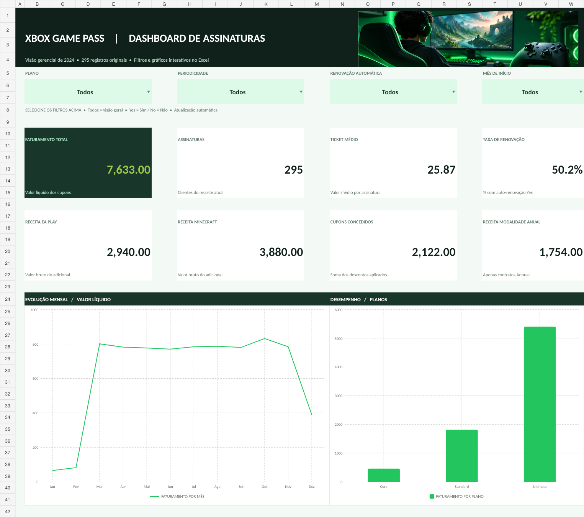

# 🎮 Dashboard Xbox Game Pass | Excel Interativo



> **Projeto de análise de dados e Business Intelligence** desenvolvido no Microsoft Excel a partir de uma base didática de assinaturas de 2024. O objetivo é transformar dados de assinaturas em indicadores visuais, acessíveis e fáceis de explorar.

## 📌 Sobre o projeto

Este dashboard apresenta o desempenho de **295 registros de assinaturas** relacionados aos planos **Core, Standard e Ultimate**. O painel reúne métricas de faturamento, comportamento de renovação automática, periodicidade dos planos, concessão de cupons e adesão a produtos adicionais.

Além dos cálculos e gráficos, o projeto utiliza uma identidade visual inspirada no universo gamer, com imagens incorporadas ao próprio arquivo Excel.


## 📊 Indicadores e visualizações

O painel permite acompanhar:

- **Faturamento total**: soma do campo `Total Value`, já considerando cupons.
- **Quantidade de assinaturas** e **ticket médio** por registro.
- **Proporção de assinaturas com renovação automática** (`Yes`).
- **Receitas brutas dos adicionais EA Play e Minecraft**.
- **Valor total dos cupons** aplicados.
- **Faturamento de assinaturas anuais**, separado dos planos mensais e trimestrais.

Os **cinco gráficos** apresentam a evolução mensal da receita, a composição por plano, a receita por periodicidade, a comparação por renovação automática e o desempenho dos adicionais.

## 🕹️ Filtros interativos

No topo da aba `Dashboard`, selecione as opções dos quatro filtros verdes:

| Filtro | O que permite analisar |
| --- | --- |
| **Plano** | Core, Standard, Ultimate ou Todos |
| **Periodicidade** | Monthly, Quarterly, Annual ou Todos |
| **Renovação automática** | Yes, No ou Todos |
| **Mês de início** | Meses de 2024 ou Todos |

Os KPIs e gráficos respondem à combinação dos filtros. A área **Perguntas do professor | Anual** é propositalmente fixa e mantém o recorte `Annual` para comparação com o exercício original.

## 📁 Estrutura do repositório

```text
xbox-game-pass-dashboard/
├── README.md
├── Dashboard_Xbox_Game_Pass_Gamer.xlsx
└── assets/
    ├── dashboard-preview.png
    ├── gaming-section.png
    ├── gamer-banner.png
    └── gamer-controller.png
```

## 🚀 Como utilizar

1. Baixe o arquivo **`Dashboard_Xbox_Game_Pass_Gamer.xlsx`** deste repositório.
2. Abra-o no **Microsoft Excel para desktop**, preferencialmente com o cálculo automático ativado.
3. Acesse a aba **`Dashboard`**.
4. Altere os quatro campos verdes para filtrar as informações.
5. Escolha **`Todos`** para retornar à visão geral.
6. Consulte as abas **`Analises`**, **`Base de Dados`** e **`Como usar`** quando quiser entender os cálculos ou explorar os registros.

**Não são necessárias macros, Python ou instalações adicionais para usar o painel.** O GitHub disponibiliza o arquivo para download, mas não executa sua interatividade na visualização da página.

## 🗂️ Abas da planilha

| Aba | Finalidade |
| --- | --- |
| `Dashboard` | KPIs, filtros, gráficos e seção visual gamer |
| `Base de Dados` | Registros originais e campos auxiliares para filtragem |
| `Analises` | Agregações dinâmicas e respostas às perguntas do exercício |
| `Como usar` | Orientações para navegar pelo dashboard |

## 🔎 Metodologia dos cálculos

O arquivo utiliza o conjunto de dados do exercício com campos como `Subscriber ID`, `Plan`, `Start Date`, `Auto Renewal`, `Subscription Price`, `Subscription Type`, informações sobre `EA Play Season Pass`, `Minecraft Season Pass`, `Coupon Value` e `Total Value`.

- **Faturamento líquido de cupons:** `SUM(Total Value)` no conjunto filtrado. Aqui, “líquido” significa *após cupons*, e não após tributos ou outros custos.
- **Ticket médio:** faturamento após cupons dividido pela quantidade de assinaturas filtradas.
- **Taxa de renovação automática:** assinaturas com `Auto Renewal = Yes` divididas pelo total filtrado.
- **Receitas dos adicionais:** soma dos valores dos respectivos passes, antes de deduzir cupons.
- **Recorte anual:** registros com `Subscription Type = Annual`, separados dos contratos `Monthly` e `Quarterly`.

### Visão geral da base, sem filtros

| Indicador | Resultado |
| --- | ---: |
| Assinaturas | **295** |
| Faturamento após cupons | **7.633,00** |
| Ticket médio | **25,87** |
| Renovação automática (`Yes`) | **50,2%** |
| Receita bruta de EA Play | **2.940,00** |
| Receita bruta de Minecraft | **3.880,00** |
| Assinaturas com periodicidade anual | **71** |

**Nota:** a base fornecida não informa a moeda. Por isso, os valores são apresentados **sem símbolo monetário**.

## 🛠️ Ferramentas e competências

- **Microsoft Excel:** modelagem, fórmulas, validação de dados, gráficos e formatação.
- **Análise de dados:** tratamento, agregação, comparação de segmentos e indicadores.
- **Business Intelligence:** construção de KPIs e comunicação visual.
- **Dashboard design:** navegação simples, identidade visual gamer e foco em usabilidade.

## 📚 Contexto acadêmico

O projeto foi criado a partir de uma **base didática e de um modelo de exercício apresentados em aula**, com melhorias no layout e na experiência de navegação. Não representa dados oficiais da Microsoft, do Xbox ou do Game Pass.

As ilustrações foram criadas especialmente para a apresentação visual deste dashboard.

---

⭐ **Se este projeto for útil, considere marcar o repositório com uma estrela!**
